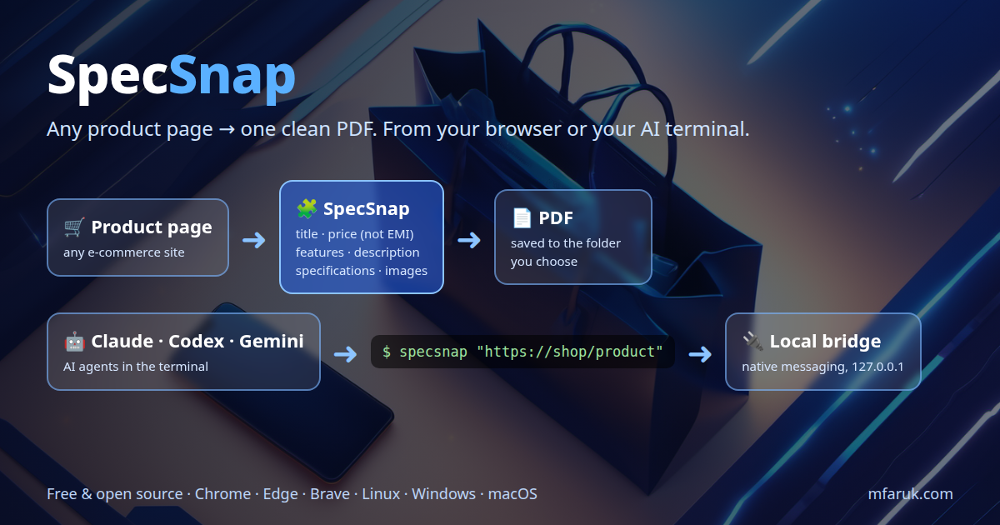

# SpecSnap — Product Page to PDF



**SpecSnap** is a free, open-source Chrome extension that turns any e-commerce product page into one clean PDF:
**title, price (the real price, not the EMI / monthly one), features, description, specifications and product images.**

Use it two ways:
- **In the browser** — click the icon, review what it found in the side panel, press *Save PDF*.
- **From the terminal / AI agents** — `specsnap "https://shop/product"` lets Claude Code, Codex, Gemini CLI (or your own scripts) grab product PDFs or JSON through your real browser.

Created by **[Mahmud Farooque](https://mfaruk.com)** · Blog post: [mfaruk.com/blog](https://mfaruk.com/blog)

---

## Features
- Works on **any** shop — no per-site setup. Uses structured data (JSON-LD, microdata, meta tags) first, then headings, tabs and accordions named *Description, Features, Key Features, Specification, Details, Highlights, Overview, About this item, In the box…*
- **Price** = the selling price. EMI / per-month / installment and struck-through "was" prices are ignored.
- **Images** = the product's own pictures (matched against the title words, gallery position and size), taken **exactly as the page shows them** — logos, icons and "related products" are filtered out.
- Edit the title/price and untick sections or images before saving.
- Save to **a folder you choose**, a Downloads sub-folder, or *Ask every time*.
- PDF with Unicode font (₹ € £ ™ ° × …), spec tables, page numbers and a source link.
- **Terminal/AI bridge** with a token-protected localhost API.

## Install the extension (all platforms)
1. Download this repo (`git clone https://github.com/mmhfarooque/specsnap` or *Code → Download ZIP* and unzip).
2. Open `chrome://extensions` (Edge: `edge://extensions`, Brave: `brave://extensions`) → turn on **Developer mode**.
3. **Load unpacked** → select the `specsnap` folder.
4. Pin SpecSnap and click it on any product page. ⚙ sets where PDFs are saved.

Works in Chrome, Chromium, Edge, Brave, Vivaldi and other Chromium browsers on **Linux, Windows and macOS** — the extension itself is the same everywhere.

## Terminal / AI bridge (optional)
Needs Python 3. Run once, then reload the extension:

| OS | Command |
|---|---|
| Linux / macOS | `bash bridge/install.sh` |
| Windows | `powershell -ExecutionPolicy Bypass -File bridge\install.ps1` |

```bash
specsnap --status                          # browser + extension connected?
specsnap "https://shop/product"            # PDF into the current folder (prints its path)
specsnap "https://shop/product" -o x.pdf   # exact output file
specsnap "https://shop/product" --extract  # JSON only: title, price, sections, images
specsnap --current                         # the tab you're looking at
```
For AI agents, point them at [`bridge/AI_USAGE.md`](bridge/AI_USAGE.md).

### How it works
```
specsnap CLI / AI ──HTTP + token──▶ bridge/host.py (127.0.0.1:8777)
                                        ▲  native messaging (started by the browser)
                                        ▼
                     SpecSnap extension service worker
                       ├─ opens the URL in a background tab, runs extractor.js
                       └─ offscreen page downloads images + builds the PDF (jsPDF)
                                        ▼
                         host.py writes the PDF to disk
```
The extension has a fixed ID (`haladpoicgmbenfflejlcgjmlgjompik`, from `key` in `manifest.json`), so the bridge only talks to SpecSnap.
Snap-packaged Chromium (Ubuntu) and Flatpak browsers sandbox native messaging — use the .deb/.rpm Google Chrome, Edge or Brave for the bridge (the extension alone works everywhere).

## Project layout
| File | Purpose |
|---|---|
| `extractor.js` | injected into the page; finds title, price, sections, images |
| `panel.html/js/css` | side-panel UI, image preview, saving |
| `pdf.js` | PDF layout (jsPDF + DejaVu Sans) |
| `images.js` | shared image downloader |
| `background.js`, `offscreen.*` | service worker + PDF builder for the terminal bridge |
| `options.*`, `storage.js` | settings (save location, images per page, max size) |
| `bridge/` | native host, `specsnap` CLI, installers for Linux/macOS/Windows |

## Limits
- Bengali / CJK text needs another font (DejaVu covers Latin, Greek, Cyrillic and symbols).
- Content that only loads after clicking a tab: click it, then press ↻ Rescan.
- Some shops block automated image downloads; those tiles show "failed".
- Respect each website's terms of use; SpecSnap is meant for personal research, comparison and record-keeping.

## Credits & license
Made by **Mahmud Farooque** — [mfaruk.com](https://mfaruk.com). MIT License (see `LICENSE`).
Uses [jsPDF](https://github.com/parallax/jsPDF) (MIT) and DejaVu fonts.
If SpecSnap helps you, a link back to [mfaruk.com](https://mfaruk.com) is appreciated.
